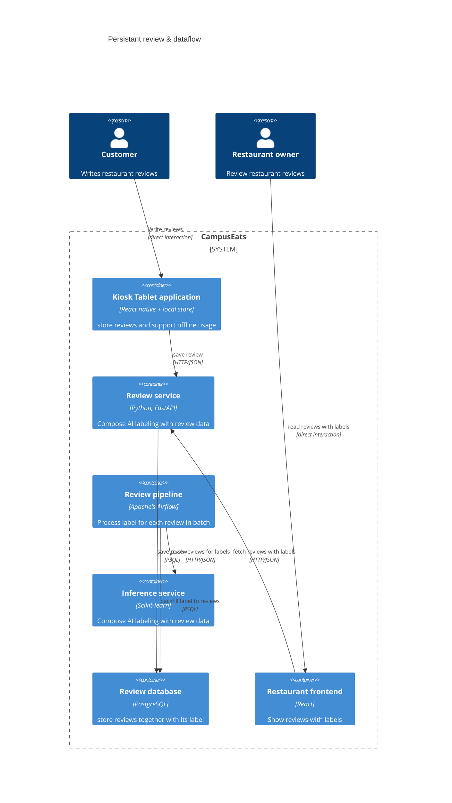

# Task 4: Deployment topologies and trade-offs

**Name / ชื่อ:** อมร พันธุรัตน์

**Student ID / รหัสนิสิต:** 6632250621

This is **individual work**: each student completes and submits their own copy, in their own fork.

*งานนี้เป็น*งานเดี่ยว* นิสิตแต่ละคนทำและส่งงานของตัวเอง ใน fork ของตัวเอง*

**Scenario (A, B or C) / Scenario ที่เลือก:**

Choose **one** scenario below. If the last digit of your student ID is odd, take A or B; if it is even, take B or C. Use your measurements from Tutorial 6 as evidence: cite run names from `results/runs.csv`. Answer in Thai or English.

เลือก scenario **หนึ่ง** ข้อด้านล่าง ถ้าเลขตัวสุดท้ายของรหัสนิสิตเป็นเลขคี่ ให้เลือก A หรือ B ถ้าเป็นเลขคู่ ให้เลือก B หรือ C ใช้ผลการวัดจาก tutorial ที่ทำไปเป็นข้อมูลอ้างอิง โดยอ้างชื่อ run จาก `results/runs.csv` จะตอบเป็นภาษาไทยหรือภาษาอังกฤษก็ได้

Facts that hold in every scenario / ข้อเท็จจริงที่ใช้กับทุก scenario:

- The large model serves at most **20 calls per second** (4 calls at once × about 200 ms each), and every call costs money.

  _large model รับได้สูงสุด **20 calls ต่อวินาที** (พร้อมกัน 4 calls × ประมาณ 200 ms ต่อ call) และทุก call มีค่าใช้จ่าย_

- The small model is fast and cheap enough to run anywhere, including inside the review service or on a kiosk, but it is much less accurate on its own.

  _small model เร็วและถูกพอที่จะรันที่ไหนก็ได้ รวมถึงภายใน review service หรือบน kiosk แต่ถ้าใช้ตัวเดียวจะแม่นน้อยกว่ามาก_

## Scenarios

**A. Owner alerts.** When a customer posts a negative review, the restaurant owner gets a push notification within **2 seconds**. At the lunch peak, CampusEats receives **40 reviews per second**. A missed alert is acceptable, but a wrong alert (for example, "your customer is unhappy" when they are happy) makes owners stop trusting alerts and, in the end, ignore them.

_เมื่อลูกค้าโพสต์รีวิวเชิงลบ เจ้าของร้านจะต้องได้รับ push notification ภายใน **2 วินาที** เวลาช่วงพีคตอนเที่ยง CampusEats ได้รับรีวิวจำนวน **40 รายการต่อวินาที** การพลาด alert ไปบ้างนั้นยอมรับได้ แต่ alert ที่ผิด (เช่น "ลูกค้าไม่พอใจ" ทั้งที่จริงๆ แล้วพอใจ) จะทำให้เจ้าของร้านไม่เชื่อถือและเลิกสนใจ alert ในที่สุด_

**B. Canteen kiosk.** A tablet in each canteen lets students leave a review on the spot. However, the canteen Wi-Fi is poor: the tablets lose their connection several times a day, for minutes at a time. The system must accept every review, even while a tablet is offline. Restaurant owners need the labels **by the end of the day**.

\*มี tablet ในแต่ละโรงอาหารให้นิสิตรีวิวได้ทันที อย่างไรก็ดี การเชื่อมต่อ Wi-Fi ในโรงอาหารไม่ดี ทำให้ tablet หลุดการเชื่อมต่อวันละหลายครั้ง ครั้งละหลายนาที ระบบจะต้องรับรีวิวได้ทุกรายการแม้ขณะที่กำลัง offline อยู่ และเจ้าของร้านต้องการ label **ภายในสิ้นวัน\***

**C. Weekly report.** Restaurant owners want a weekly sentiment report. Nothing in producing this report has to be real-time. **Accuracy matters most** and **cost must be minimal**.

\*เจ้าของร้านต้องการรายงาน sentiment รายสัปดาห์ ไม่มีอะไรที่จะต้องทำแบบ real-time ในการออกรายงานนี้ ความแม่นยำ **(accuracy) สำคัญที่สุด** และ **ค่าใช้จ่ายต้องน้อยที่สุด\***

## Topologies and patterns to choose from / Topology และ pattern ที่เลือกใช้ได้

|     | Topology                        | Where the model runs / โมเดลรันที่ไหน                                                                                                        |
| --- | ------------------------------- | -------------------------------------------------------------------------------------------------------------------------------------------- |
| T1  | Model as a service, synchronous | Inference service, called for each review (today's baseline) _inference service ถูกเรียกทุกรีวิว (baseline ของวันนี้)_                       |
| T2  | Model as a library              | Inside the review service, or on the device _ภายใน review service หรือบนอุปกรณ์_                                                             |
| T3  | Hybrid                          | Small model locally, large model as a remote service _small model รันในเครื่อง large model เป็น remote service_                              |
| T4  | Asynchronous / batch            | Reviews are queued (broker, W10) or stored, and scored later in bulk _รีวิวถูกเข้าคิว (broker, W10) หรือเก็บไว้ แล้วติด label ทีหลังเป็นชุด_ |

Combine one topology with any of the patterns from Tutorial 6: **fallback**, **cascade** and **cache**.

\*เลือก topology หนึ่งแบบ แล้วผสมกับ pattern จาก Tutorial 6 ได้ตามต้องการ: **fallback**, **cascade** และ **cache\***

## 1. Quality requirements

The three most important quality requirements for your scenario, each with a number where possible.

_quality requirements ที่สำคัญที่สุด 3 ข้อของ scenario ที่เลือก ระบุตัวเลขเมื่อทำได้ (Scenario B)_

| #   | Quality           | Requirement                                                                                          |
| --- | ----------------- | ---------------------------------------------------------------------------------------------------- |
| 1   | Availability      | ต้องสามารถใช้งาน tablet ได้แม้ว่าจะขาดการเชื่อมต่อกับอินเตอร์เน็ตก็ตาม                               |
| 2   | inference latency | ต้องสามารถประมวลผลข้อมูลทั้งหมดก่อนที่จะสิ้นวันได้                                                   |
| 3   | throughput        | โมเดลขนาดใหญ่ที่มีความแม่นสามารถประมวลผลได้ 20 req / s โดยสามารถทำ concurrent request ได้ 4 requests |

## 2. Design / การออกแบบ

Your topology, the patterns you add, and a container-level diagram (C4 level 2). The C4 diagram must be written in Mermaid.

_topology ที่เลือก pattern ที่เพิ่ม และ diagram ระดับ container (C4 level 2) เขียนด้วย Mermaid_

## 3. Evidence / หลักฐาน

Which runs support your choice? Show the numbers and, for scenario A, the capacity arithmetic: how many large-model calls per second does your design need at the peak?

_run ไหนที่สนับสนุนการตัดสินใจของนิสิต ให้นิสิตแสดงตัวเลขประกอบ และสำหรับ scenario A ให้นิสิตแสดงการคำนวณ capacity ด้วย เพื่อแสดงว่าในช่วงพีคนั้น design ของนิสิตต้องใช้ large model กี่ calls ต่อวินาที_

| Run      | What it shows / แสดงอะไร                                                                                                                                                                                                                                                                                                                 |
| -------- | ---------------------------------------------------------------------------------------------------------------------------------------------------------------------------------------------------------------------------------------------------------------------------------------------------------------------------------------- |
| t2-0.6   | บ่งบอกว่าการใช้งาน threshold เพื่อการทำการเรียก AI แบบ cascade นั้นสามารถช่วยลดเวลาในการประมวลผลได้ โดยการใช้งาน threshold เพื่อทำ cascade นั้นจะทำให้สามารถประมวลผลข้อมูลบางส่วนที่มี confident สูงภายในเครื่อง kiosk ได้ แล้วจึงใช้งาน dataflow architecture เพื่อที่จะประมวลผลตัวอื่น ๆ ที่สามารถประมวลผลได้ยากใน server ในภายหลังแทน |
| t0-small | บ่งบอกว่าโมเดลเล็กนั้น ใช้เวลาน้อยกว่าโมเดลใหญ่มาก แต่ว่ายังคง accuracy ไว้ที่ประมาณ 72.5% ซึ่งถือว่าพอใช้งานได้สำหรับคำตอบที่มีความมั่นใจสูงเมื่อนำมาประกอบกันเป็นแบบ cascade                                                                                                                                                           |

## 4. ADR

Use the ADR format from W5.

_ใช้รูปแบบ ADR จาก W5_

**Title:** การทำงานของระบบ review และ การ label ภายใน scenario B

**Status:** Proposed

**Context:** เนื่องจากว่าการทำงานของระบบรีวิวมี constraint หลัก ๆ ในเรื่องของ accesibillity ที่ต้องทำงานแม้ว่าอินเตอร์เน็ตจะไม่เสถียร หรือแม้แก่ internet ถูกตัดการเชื่อมต่อ และ มี time constraint ที่ว่าเจ้าของร้านจะต้องสามารถทำการดู label ของ รีวิวได้ภายในสิ้นวัน ดังนั้นจึงต้องมีการออกแบบเพื่อที่จะให้สามารถรองรับการใช้งานที่ตอบโจทย์ constraint ทั้งสองอย่างนี้เป็นหลัก โดยได้มีการพิจารณา topology ที่หลากหลายไม่ว่าจะเป็น การทำ synchronous model inference, การใช้ model บนเครื่อง, การแยก model เล็กไว้บนเครื่อง และใช้งาน model ใหญ่บน server และ การประมวลผลด้วย AI แบบ asynchronous ด้วย message queue และ การประมวลผลแบบ batched และได้มีการเปรียบเทียบระหว่าง pattern ต่าง ๆ เพิ่มเติม เช่น caching, cascading และ fallback

**Decision:** เลือกการใช้งาน Topology T4 (asynchronous / batch queue) ร่วมกับ cascade เพื่อเพิ่มความเร็วของ dataflow pipeline

**Consequences:**

- Positive:
  - สามารถลดเวลาการประมวลผลจากการทำ pipeline แบบปกติด้วยการใช้งานการทำงานแบบ cascade ของ inference pipeline
  - สามารถประมวลผลข้อมูลย้อนหลังทำให้ไม่ต้องกังวลเกี่ยวกับเรื่องของการต่ออินเตอร์เน็ตที่สเถียรระหว่างการทำ ML inference
- Negative:
  - ต้องมีการ implement ในส่วนของ persistant store เพิ่มเติมใน kiosk tablet เนื่องจากว่าต้องสามารถรองรับการส่งข้อมูลทั้งหมดที่บันทึกไว้ไปประมวลผลในภายหลังได้
  - เจ้าของร้านจะไม่สามารถได้รับข้อมูลทันทีหลังการประมวลผลได้
  - หาก pipeline fails จำเป็นที่จะต้องมีการรันใหม่สำหรับข้อมูลที่ยังไม่ได้ถูก backfill labels

**Alternatives considered:** at least one topology you rejected, and why.

_อย่างน้อยหนึ่ง topology ที่ไม่เลือก และเหตุผล_

> T1 (การรัน inference แบบ synchronous) สามารถใช้งานได้ในสภาวะปกติ แต่ในกรณีที่อินเตอร์เน็ตไม่มีความเสถียรนั้นจะทำให้การทำงานของระบบช้าลงและอาจจะมีโอกาสผิดพลาดมากขึ้น

> T2 ที่เป็นการใช้งาน library ใน service หรือ on device นั้น จะมีข้อจำกัดในเรื่องของผลลัพธ์เนื่องจากว่าหากรันในรูปแบบนี้โมเดลจำเป็นที่จะต้องทำงานเร็วและเก่ง แต่สิ่งนี้เป็น trade-off ที่สำคัญหากต้องการที่จะประมวลผลแบบ real time

> T3 ที่เป็นการเรียก model เล็กใน local แต่ เรียกโมเดลใหญ่ใน server นั้นก็ไม่ได้รับเลือกเนื่องจากว่า ตาม scenario B อินเตอร์เน็ต ณ บริเวณดังกล่าวนั้น ไม่เร็วและเสถียรพอที่จะทำ cascading ด้วย Topology T3 ได้อย่างมีประสิทธิภาพ
